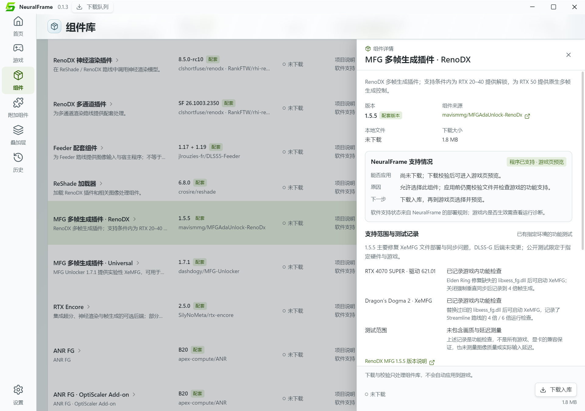
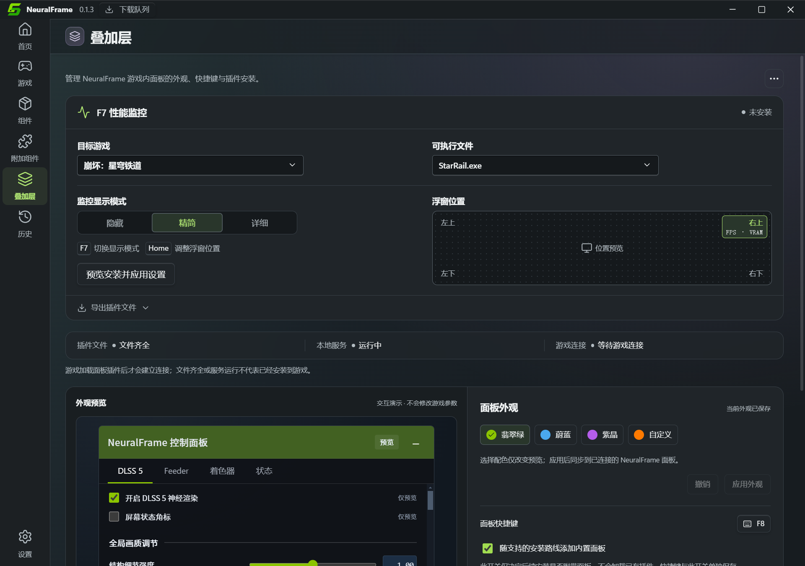

<h1 align="center">NeuralFrame</h1>

<strong>Windows 游戏的超分辨率、神经渲染与帧生成管理器</strong>

<a href="https://github.com/lxl2000927/NeuralFrame/releases/download/v0.1.4/NeuralFrame-0.1.4-Setup-x64.exe"><strong>下载安装版</strong></a> · <a href="https://github.com/lxl2000927/NeuralFrame/releases/download/v0.1.4/NeuralFrame-0.1.4-Portable-x64.exe">下载便携版</a> · <a href="https://github.com/lxl2000927/NeuralFrame/releases/tag/v0.1.4">0.1.4 发行页</a>

NeuralFrame 根据每款游戏的可执行文件、图形 API 和显卡列出可用组件。你可以比较模型和补帧引擎，先预览将要改动的文件，再按游戏应用配置。当前发行包适用于 **Windows x64**，附带简体中文与英文界面。

| 我想了解 | 阅读入口 |
| --- | --- |
| 第一次安装、配置一款游戏，或恢复原始文件 | [功能与操作指南](docs/FEATURES.md) |
| 某个 DLL 是谁提供的，为什么有多个同名版本 | [组件来源与用途](docs/COMPONENTS.md) |
| 倍率、工作分辨率、切镜保护或 HDR 白点怎么调 | [参数手册](docs/PARAMETERS.md) |
| 没有原生 DLSS 的游戏或 AMD 显卡能用什么 | [游戏适配与补帧路线](docs/GAME-ROUTES.md) |

## 配置第一款游戏

1. 在「首页」点 **扫描游戏库**。也可以在「游戏」点 **添加游戏**，指定本机安装目录。
2. 在「游戏 → 画质与补帧」核对真正渲染画面的 EXE 和图形 API。想改善画面时查看超分与神经渲染，想增加显示帧时查看帧生成。页面按当前程序列出可用选项。
3. 关闭游戏，下载提示缺少的组件，点 **预览并应用**。确认文件清单后重启游戏，在实际场景打开「运行诊断」查看加载状态。需要撤回整套部署时，关闭游戏，在 **更多操作 → 一键卸载并恢复** 中还原。

## 我的显卡和游戏能用什么

| 使用场景 | 从哪里开始 |
| --- | --- |
| RTX 20 / 30 / 40 | 先看游戏是否有 DLSS 超分或 DLSS-G 输入。神经渲染还需要与实际 GPU 架构匹配的模型。社区补帧插件按引擎、游戏和驱动分别判断。 |
| RTX 50 | 原生支持 DLSS 多帧生成。可在支持的游戏中管理倍率、运行库和模型，神经渲染模型需支持 Blackwell 架构。 |
| Radeon，无原生补帧 | 64 位 DX12 游戏如提供可读取的 XeSS 或 FSR 3.1+ 超分，可尝试独立 XeMFG。已有兼容 OptiScaler 宿主时可看 XeMFG 插件或 OptiFG。符合条件的显卡也可在 AMD Software 中启用 AFMF。 |
| 游戏没有原生 DLSS 超分 | NVIDIA RTX 可根据 API 查看 Feeder 或 RenoDX DLSS Tool；无原生帧生成的离线游戏还可查看 RTX Encore。每条路线需要的输入不同。[RTX Encore 使用条件](docs/ENCORE.md) |

| 组件库 · 核对作者与适配版本 | 叠加层 · 为目标程序配置监控 |
| --- | --- |
|  |  |

## 源码与项目来源

想运行或重新打包桌面应用，可下载含原生启动组件和 F8 桥接的源码包。安装版、便携版和源码包共用一份 SHA-256 清单。[源码包](https://github.com/lxl2000927/NeuralFrame/releases/download/v0.1.4/NeuralFrame-0.1.4-Source.zip) · [校验清单](https://github.com/lxl2000927/NeuralFrame/releases/download/v0.1.4/SHA256SUMS.txt) · [开发与构建](docs/BUILDING.md)

NeuralFrame 基于 skyi7943-cmd 的 DLSS5-Swapper-Enhanced 2.3.0，继承 Rakan Alkhaldi 的 DLSS 5 Swapper（截至 v2.2.9）的 MIT 代码。桌面布局参考 NVIDIA App。管理器使用 MIT 许可，模型、运行库与插件遵循各自许可。[Enhanced 上游](https://github.com/skyi7943-cmd/DLSS5-Swapper-Enhanced) · [MIT 许可](LICENSE) · [第三方声明](THIRD_PARTY_NOTICES.md)

[文档索引](docs/README.md) · [项目进度](PROJECT_STATUS.md) · [本版更新](RELEASE-NOTES.md)
